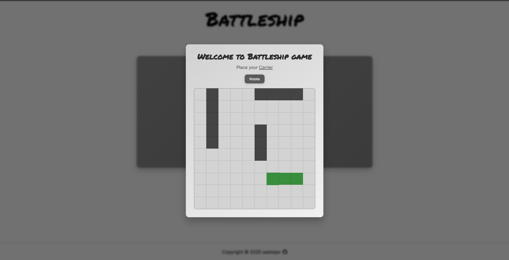

# Battleship

A modular, test-driven implementation of the classic Battleship game built in vanilla JavaScript, emphasizing Object-Oriented Design (OOD) and Test-Driven Development (TDD) with Jest.



## Live Demo
Play the game live: **[sadwipebattleship.netlify.app](https://sadwipebattleship.netlify.app/)**

---

## Architecture & Engineering Highlights

* **Test-Driven Development (TDD):** Domain logic and game rules were designed and verified test-first using **Jest**, ensuring complete test coverage for coordinate boundaries, ship positioning constraints, and attack resolutions prior to DOM integration.
* **Separation of Concerns:** Clean decoupling between pure business logic (`models/`), DOM manipulation (`ui/`), and execution orchestration (`gameController.js`). Core game mechanics run completely independent of browser rendering.
* **Object-Oriented Design:** Modular factory architecture modeling `Ship`, `Gameboard`, and `Player` entities with encapsulated state management and validation guards.
* **Opponent AI Logic:** Automated computer player managing legal move selection and turn progression against human opponents without repeating moves.
* **Build Tooling & Quality:** Bundled via **Webpack**, transpiled with **Babel**, and enforced with strict **ESLint** and **Prettier** standards.

---

## Key Features

* **Interactive Ship Placement:** Dedicated setup modal supporting grid-bound directional rotation.
* **Turn-Based Combat System:** Coordinated target evaluation handling misses, direct hits, and ship sunk events.
* **Automated Game Loop:** Real-time evaluation of win/loss conditions when all ships on a board are neutralized.
* **Input Validation:** Prevents out-of-bounds placements, overlapping vessels, and repeated attacks on the same coordinates.

---

## Tech Stack

* **Language:** JavaScript (ES6+ Modules)
* **Testing:** Jest, Babel
* **Build System:** Webpack
* **Code Standards:** ESLint, Prettier
* **Markup & Styles:** Semantic HTML5, Modular CSS3
* **Hosting:** Netlify

---

## Getting Started

### Prerequisites
* Node.js (v18 or higher recommended)
* npm (bundled with Node.js)

### Installation
1. Clone the repository:
   ```bash
   git clone https://github.com/sadwipe/Battleship.git
   cd Battleship
   ```

2. Install dependencies:
   ```bash
   npm install
   ```

### Available Scripts

* **Run Test Suite:**
  ```bash
  npm test
  ```
  Runs all Jest unit test suites for models, factories, and game mechanics.

* **Development Server:**
  ```bash
  npm start
  ```
  Compiles assets and starts the local Webpack dev server.

* **Production Build:**
  ```bash
  npm run build
  ```
  Generates minified, production-ready static assets in the `dist` folder.
